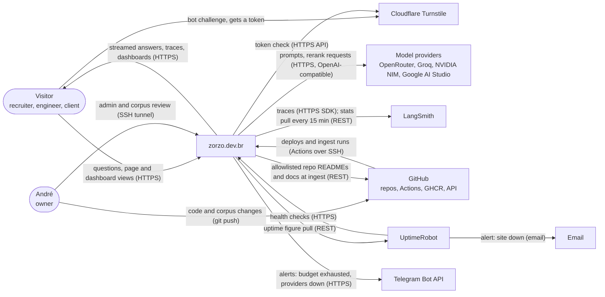
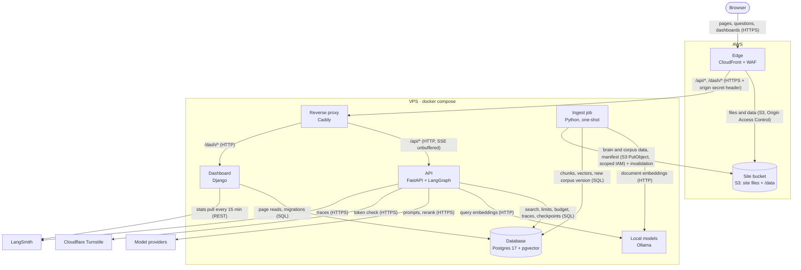
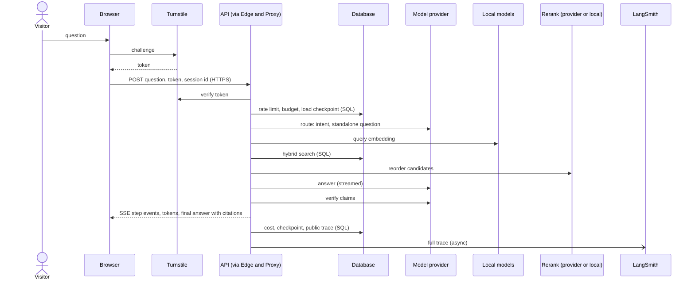

# HLD — zorzo.dev.br

2026-11-26 · André de Castro Zorzo · Status: draft · LLD: [lld.md](lld.md) · Brief: [product-brief.md](product-brief.md)

## 1. Context and goals

zorzo.dev.br is the professional site of André de Castro Zorzo. It has three parts: a static front
(animated brain and a query box), an API where an AI agent answers questions from a curated corpus with
citations, and public dashboards that show traces, evals, blocked attacks and cost. It serves recruiters,
engineering managers and the engineers who run technical evaluations at US and European companies, plus
freelance clients. Because the source code is public, the system is also a reference implementation: a
way to learn the full path (RAG, agent, evals, guardrails, observability, cost control) and a base that
can be adapted to other domains, such as a law firm searching its case files or an engineering firm
searching its projects, by swapping the corpus, prompts, tools and evals rather than the core. Phase:
MVP, launching on 2026-12-04.

Features that weigh most on the design:

- **Streamed answers with live steps:** a long-lived stream through the CDN, with each pipeline step sent
  as it happens.
- **Agent over external models:** retrieval, guard, verification, and a fallback chain across free and
  paid providers that have quotas and outages.
- **Versioned corpus:** a new corpus version is activated all at once, and the front's brain data follows
  it without a front deploy.
- **Public traces and dashboards:** fed from LangSmith and from Postgres.
- **Cost and abuse controls:** cost counted per request, a daily cap, and degraded mode when the cap or the
  providers fail.
- **Conversation context within a visit:** state kept per anonymous session, with a TTL.

**Architecture goals**

1. The site keeps answering when a model provider fails or runs out of quota: it degrades, it never goes
   blank.
2. No path can spend beyond the budget; when money runs out, the site degrades instead of spending.
3. No change to models, prompts or corpus reaches production without a measured comparison against the
   current version.
4. Domain-specific parts (corpus, prompts, intents, tools, evals, public layer) can be swapped without
   touching the core.
5. Anyone can run the whole system locally, without the owner's accounts.
6. Security never depends on the code being secret.

**Non-goals**

1. **A multi-tenant platform or framework:** no plugins, no configuration UI. Adapting to another domain
   means forking and swapping parts.
2. **High availability with redundancy:** one VPS, no failover or second region. A machine failure means
   downtime until it is restored.
3. **Microservices or a container orchestrator:** two Python apps in docker compose, no Kubernetes.
4. **Local answer models in production on this server:** answers in production come from external
   providers, because the server has no GPU. Any OpenAI-compatible endpoint (Ollama, vLLM, llama.cpp) can
   replace them by configuration, which is how the local profile runs without accounts.
5. **Tools with side effects:** every tool is read-only.
6. **Visitor accounts or authentication:** visitors are anonymous; only the owner has privileged access,
   and never through the public edge.
7. **Zero-downtime deploys:** a deploy may cause a short restart, with automatic rollback if it fails.

### Stakeholders

| Role | What they need from the architecture | Where they find it |
| --- | --- | --- |
| André (owner, maintainer) | The reasons behind each decision, to explain them in interviews | The ADRs, this HLD |
| AI coding agents (skills workflow) | Boundaries between parts, contracts, what not to change | This HLD, the LLD, `AGENTS.md` |
| Engineers evaluating André | A fast picture of the system and proof that it works | Sections 1 and 5 of this HLD, public dashboards and traces |
| Developers and teams adapting it | Which parts are core and which are domain, and how to run it locally | Section 5 (core and domain), section 9, README |

## 2. Constraints

| Type | Constraint | Origin |
| --- | --- | --- |
| Technology | LangChain/LangGraph (agent), LangSmith (tracing), FastAPI (API), Django (dashboard) | Product brief: the site exists to show these tools in production |
| Budget | Recurring cost under US$10/month; a one-time US$10 model credit; no other spending | Product brief |
| Deadline | One MVP launch on 2026-12-04, only after everything works locally | Product brief |
| Team | André alone; code produced through the AI skills workflow, and he must be able to explain each part | Product brief |
| Openness | All code public on GitHub, written in English | Product brief |
| Provider terms | No extra accounts to multiply free quotas; capacity comes from other providers' own free tiers or from paid usage | André's rule (decisions log, 2026-11-19) |
| Legal | LGPD and GDPR apply to any visitor data (owner in Brazil, visitors in the US and Europe) | Spec, "What is stored" |

## 3. Quality requirements

| Priority | Attribute | Criterion |
| --- | --- | --- |
| 1 | Groundedness | Faithfulness ≥ 0.90 on the public eval set; every answer cites its sources; questions outside the corpus get "not in my sources" (abstention-rate target on the unanswerable set: TBD after the first baseline) |
| 2 | Cost control | Recurring cost < US$10/month; daily model spend never exceeds the daily cap (when the cap is reached, the next request is already served in degraded mode) |
| 3 | Security | Zero canary or system-prompt leaks on the adversarial eval set; scripted traffic can't push spend past the cap |
| 4 | Resilience | With the main provider failing (429, timeout), the visitor still gets an answer from another provider, or search results with a notice |
| 5 | Performance | First words of an answer within 3 s at p95 for US visitors; no request runs longer than 20 s |
| 6 | Availability | Always on, no cold start; uptime target: TBD |
| 7 | Adaptability | A new domain runs by changing corpus, prompts, intents, tools and evals, with no change to core modules; a fresh clone runs locally without any account |

Sizing hypotheses, without real data: up to about 200 questions/day (free quota), up to 20 concurrent
sessions (load test), a few thousand chunks. The design is revisited if production misses the quota or
the latency targets.

## 4. System context

**System context**

Rounded boxes are people; rectangles are systems; zorzo.dev.br is the system described here.

| External system | What for | How | Who initiates |
| --- | --- | --- | --- |
| Model providers | Answers, routing, verification, rerank | HTTPS, OpenAI-compatible | zorzo.dev.br |
| LangSmith | Traces in; stats and experiments out | HTTPS SDK + REST pull | zorzo.dev.br |
| Cloudflare Turnstile | Bot check | Browser widget + server-side verify | Visitor (widget), zorzo.dev.br (verify) |
| GitHub | Code, CI/CD, image registry, ingest trigger, repo content | Actions over SSH, REST API | GitHub (deploy, ingest), zorzo.dev.br (repo fetch) |
| UptimeRobot | External availability check; uptime figure for `/status` | HTTPS probe; REST pull | UptimeRobot (probe), zorzo.dev.br (pull) |
| Telegram Bot API | Alerts to the owner from the API | HTTPS | zorzo.dev.br |
| Email | Site-down alert to the owner, straight from UptimeRobot (its free plan has no Telegram), so it arrives even when the VPS is down | SMTP (UptimeRobot) | UptimeRobot |

AWS (CloudFront, S3, Route 53, WAF) and the VPS are where the system runs, not external systems: see
sections 5 and 9.

## 5. Architecture

A static front on a CDN and one always-on VPS that runs the backend in docker compose: FastAPI for the
streaming API and the agent, Django for the public dashboards, both on one Postgres. The browser sees a
single origin through CloudFront, and the backend is a generic RAG and agent core whose domain parts
(corpus, prompts, intents, tools, evals) are content and configuration.

**Containers**

Rectangles are containers that run; cylinders store data; external systems sit outside the subgraphs.

| Container | Responsibility | Technology |
| --- | --- | --- |
| Edge | Routes `/*` to the bucket and `/api/*`, `/dash/*` to the VPS; filters abuse | CloudFront + WAF |
| Site bucket | Static site (HTML, JS, the Three.js brain) and `/data/` (brain and corpus data, manifest) | S3, private, read through CloudFront |
| Reverse proxy | Checks the origin secret, routes to API or dashboard, never buffers streams | Caddy |
| API | Gate, guard, agent, retrieval, rerank, verification, SSE | FastAPI + LangGraph |
| Dashboard | Public pages, schema migrations, scheduled pull of LangSmith and UptimeRobot figures | Django |
| Database | Chunks, vectors, full-text, limits, budget, traces, conversation state; nightly dump to a separate S3 bucket | Postgres 17 + pgvector |
| Local models | Embeddings; in the local profile, also answers | Ollama |
| Ingest job | Corpus → database; brain data → S3 | Python, one-shot |

The local reranker (ONNX) runs inside the API as a module, not as a container.

**API style.** The public API is small and versioned in the path (`/api/v1/…`). Its main call takes a
question and returns an SSE stream of pipeline events; a health endpoint serves the front, the deploy
smoke test and the uptime monitor. It is anonymous: requests carry a Turnstile token and an anonymous session id, never user
credentials. Its only consumer is the static front, which tests against a JSON Schema contract published
by the backend; a breaking change means `/v2`. The route-by-route contract is in the LLD.

**Core and domain.** The split that makes the system adaptable (goal 4, ADR 0011).

| Core module (generic) | Responsibility |
| --- | --- |
| Gate | Bot token, rate limit, budget check |
| Guard | Injection and abuse classification |
| Agent graph | route → retrieve → assess → answer → verify → emit, with bounded retries and abstention (ADR 0006) |
| Retrieval | Hybrid search, fusion, rerank chain |
| Verification | Claim-level grounding check, output guard |
| Model gateway | Provider chain with fallback, cost accounting per call |
| Telemetry | SSE events, traces, public redacted trace |
| Ingest pipeline | Scan, extract, chunk, embed, version, activate |
| Eval harness | Datasets in, metrics and gate out |

| Domain part (content and configuration) | What it holds |
| --- | --- |
| Corpus | Documents and their authority and metadata rules |
| Persona and prompts | Answer contract, voice (third person) |
| Intents | What `route` classifies (`career_fact`, `about_system`…) |
| Tools | Read-only tools specific to the domain |
| Eval datasets | Golden, unanswerable, adversarial… |
| Public layer | Dashboards and public traces, which can be switched off for a private deployment |

Phase 2's career graph enters as a new answer path that `route` can pick, fed by domain data (certified
facts), without changing the existing steps.

## 6. Main flows

### 6.1 Ask a question

The visitor types a question. The browser gets a Turnstile token and sends the question, the token and
an anonymous session id to `/api/v1/ask`, through CloudFront (WAF rate limit) and Caddy. The API first runs
the gate (token, rate limit, budget; it fails closed), whose refusals are plain HTTP errors. Then it opens
an SSE stream and runs the agent graph: guard (injection and abuse), route (intent, and a follow-up
rewritten into a standalone question using the session's checkpoint), a semantic cache lookup that serves
a near-duplicate question already answered and verified (ADR 0014), retrieve (query embedding from Ollama, hybrid search in Postgres, rerank), assess, answer
(streamed from the model gateway), verify (grounding; repair once, or abstain), emit. Each step sends an
SSE event, and the front lights the matching brain points; a heartbeat keeps quiet steps alive. State
that changes: rate-limit and cost counters, the session checkpoint and the public redacted trace
(Postgres); the full trace goes to LangSmith asynchronously.

Main failure: a request blocked at the WAF or the gate gets an HTTP error (403, 429), and one blocked by
the guard gets a `blocked` event; either way a defense event is counted before any model call, so it costs
nothing.

**Ask a question**

Solid arrows are calls; dashed arrows are responses and the stream; the open arrow is asynchronous.

### 6.2 Degradation

The model gateway calls each stage's chain in order: OpenRouter `:free`, then other providers' free
tiers, then OpenRouter paid within the daily budget (ADR 0007). A provider that fails or answers 429 is
skipped, and a circuit breaker keeps it out for a while, so the next requests don't wait on it. The rerank
step falls back from the provider to the local model, and then to no rerank (ADR 0009). When no answer
model is available, or the daily budget is used up, the API switches to search-only mode: it streams the
matching sources with a notice instead of an answer. Every fallback emits an event, shows up on `/status`
(active chain, breaker state, budget used) and is recorded in the trace.

Main failure: the backend is unreachable, because the API or the database is down or a deploy is
restarting them. The edge still serves the static site. The front checks a health endpoint, shows that
the backend is offline instead of failing silently, and retries until it is back.

### 6.3 Corpus ingestion and activation

A push that changes `corpus/` starts a GitHub Action, which runs the ingest job on the VPS over SSH, so
documents are embedded by the same Ollama model that embeds queries (ADR 0008). The job rejects documents
not reviewed by the owner and those where the scan finds secrets or personal data. It then extracts,
chunks, embeds and upserts by content hash into a new, inactive corpus version, and runs the evals
against it. If they pass, one transaction makes it the active version (ADR 0001). The job then rebuilds
the brain and corpus data from that version, writes it to S3 under a hashed path and updates the
manifest, so the front lights the same chunks the API serves, without a front deploy (ADR 0010).

Main failure: the scan or the evals fail. The new version stays inactive, the current one keeps serving,
and the Action fails with the report.

### 6.4 Change delivery with the eval gate

A pull request on `zorzo-api` runs lint, type checks, unit tests and an eval subset. A change to prompts,
model configuration or retrieval runs the full eval set, and merging is blocked if a gated metric
regresses beyond the noise band. On merge to main, GitHub Actions builds the image, pushes it to GHCR, and
the VPS pulls it over SSH. Django migrations run before the new containers start, and they stay backward
compatible with the previous image (add first, remove in a later deploy). A smoke test (health check plus
one golden question) decides: on failure the previous image is restored automatically. The front
(`zorzo-site`) deploys on its own: files synced to S3, then an `index.html` invalidation.

Main failure: the smoke test fails after a migration. Because migrations are backward compatible, the
previous image runs against the new schema.

### 6.5 Dashboard data

The Django pages are server-rendered from Postgres: public traces, defense events, eval runs, budget,
sources and status. A scheduled Django command pulls aggregates from LangSmith every 15 min (project
stats and experiment results, never raw traces) and the uptime figure from the UptimeRobot API, and
stores them as snapshots, so the pages never call an external service while a visitor waits and LangSmith
stays within its free plan. The pages are cached briefly at the edge.

Main failure: a pull fails. The pages show the last snapshot with its timestamp, and the failure is
logged.

## 7. Data

Main entities and where they live:

- **Corpus** (Postgres): documents → chunks, each with text, vector and full-text index, grouped by corpus
  version. Exactly one version is active; switching is one transaction (ADR 0001), and a rejected
  candidate never serves.
- **Brain and corpus data** (S3): derived from the active version, under hashed paths plus a manifest. It
  can always be rebuilt, so it is never backed up.
- **Conversation state** (Postgres, LangGraph checkpointer schema): per anonymous session, deleted after
  30 min idle.
- **Limits and budget** (Postgres): rate-limit buckets keyed by a salted hash of the IP, never the raw IP
  (salts rotate daily); daily cost and request counters, and the moment degraded mode started.
- **Public traces, defense events, questions log** (Postgres): all redacted or scrubbed of personal data,
  and all with an expiry (public traces at most 30 days; values in the LLD).
- **Answer cache** (Postgres, pgvector): verified answers keyed by the embedding of the scrubbed question,
  valid only for the same corpus and model configuration versions, with an expiry (ADR 0014).
- **Eval runs and external snapshots** (Postgres): aggregates from LangSmith and UptimeRobot, kept for the
  trend charts.
- **Full traces** (LangSmith): masked, under the provider's 14-day retention.

Rules that shape the design: no visitor personal data is stored anywhere (LGPD/GDPR); every model call's
cost is counted before the next one is allowed (budget cap); Django owns the schema, the API has no
migrations, and the checkpointer keeps its own schema; the nightly backup covers Postgres only, because
the corpus and the brain data can be rebuilt from git.

## 8. Cross-cutting concepts

### Security and privacy

- **Edge:** the WAF limits rates per IP and applies managed rule sets. Caddy rejects any request without
  CloudFront's origin secret, so the VPS can't be reached around the edge. The VPS firewall opens only
  HTTPS and key-only SSH.
- **Abuse and cost:** each question needs a Turnstile token; the app adds rate limits per hashed IP and per
  session, plus the daily budget cap. The gate fails closed.
- **Prompt injection:** layered defenses: input normalization, a classifier, retrieved text always treated
  as data, read-only tools, the model never writes SQL, and an output guard with a canary. None of them
  depends on the code being secret (goal 6). Details in the LLD.
- **Privacy:** no visitor personal data stored; questions scrubbed; public traces redacted. The corpus
  holds only owner-reviewed documents, and ingest scans for secrets and personal data.
- **Privileged access:** the Django admin and the owner's tools are reachable only through an SSH tunnel,
  never through the edge.
- **Least privilege:** S3 is private, read only by CloudFront. The VPS writes to S3 with a credential
  limited to the `data/` prefix and the manifest invalidation.

### Observability

- **Traces:** every request runs under one trace id. LangSmith gets the full trace (each step, model,
  tokens, cost, latency), with pipeline events as tags and personal data masked. Postgres keeps the public
  redacted copy.
- **Logs:** edge and infrastructure events (fallbacks, breaker trips, rate limits, deploys, ingest runs) go
  to Postgres as structured events from a closed catalog, each carrying the trace id. A metric leads to a
  trace, and the trace leads to its logs.
- **Metrics:** `/status` shows p50/p95 latency, cost per answer, budget used, the active model chain and
  breaker state, all computed from traces and counters. Quality metrics come from eval runs.
- **Alerts:** the daily budget reaching its paid cutoff (and then running out) and all answer providers down go to André on Telegram through a bot,
  from the API; site down goes by email straight from UptimeRobot, never through the API, so it arrives
  even when the VPS is down. Each alert fires once per incident, not
  on every request. Failed ingest or deploy runs are already reported by GitHub.

### Errors, retries and idempotency

- **Model calls:** a short timeout per stage. One retry only for transient errors, then the next provider
  in the chain (flow 6.2); a circuit breaker stops calling a failing provider for a while. A provider's
  "context too long" error is a bug alert, never a retry.
- **Agent loop:** bounded by design: at most one query rewrite, one repair, a few tool calls and a
  wall-clock limit per request (ADR 0006). A step that times out ends in abstention with sources, not an
  error page.
- **Streams:** if the stream drops, the visitor asks again; answers are not resumed. Asking again is safe
  because questions have no side effects, but each one counts against rate limit and budget.
- **Ingest:** upserts by content hash, so re-running the same corpus changes nothing. Activation is one
  transaction, so a crash leaves the previous version active.
- **Deploys:** the image tag makes a deploy repeatable; rollback is redeploying the previous tag.

### Configuration and secrets

- **Configuration is code:** the model chain, rerank chain, prompts, intents, tools and limits live in
  versioned files in the repo. Each answer records the corpus version and the model configuration
  version, so a change is reviewable, eval-gated (goal 3) and traceable to the answers it affected.
- **Secrets live only in the environment:** in production, an env file on the VPS readable only by its
  owner, loaded by docker compose. In CI, GitHub Actions secrets (SSH deploy key, scoped AWS
  credentials). Secrets are never in the repo, the traces or the logs.
- **Local profile:** an example env file needs no keys. It points the model gateway at Ollama, and the gate
  skips Turnstile with a test key (goal 5). Adding provider keys turns on the real chain.

### Internationalization

- **The answer follows the question's language:** English or Portuguese, detected at `route`. A question in
  one language can use sources written in the other, so the embedding model must be multilingual (choice
  between candidates in the LLD, decided by recall).
- **Corpus:** documents keep their original language, with a language tag. The résumé is English only
  (from the PDF); a question about it in Portuguese is answered in Portuguese from the English source.
- **Evals:** every gated metric is reported separately for PT and EN, since multilingual quality is the main
  unknown of the reranker and the free models.
- **Front and dashboards:** interface text in both languages; how the language is chosen is in the LLD.

## 9. Deployment and environments

| Environment | Purpose | Where it runs |
| --- | --- | --- |
| Local | Development, evals, and the reference profile for anyone who clones the repo | Docker compose on a laptop |
| Production | The public site | CloudFront + S3 (AWS) and one Contabo VPS in US East (ADR 0002) |

**Production.** One instance of each container on the VPS, kept up by compose restart policies and
systemd. Availability comes from simplicity: no redundancy (non-goal 2), UptimeRobot alerts by email,
a nightly backup with a monthly restore test, and a VPS rebuildable from the repo. There is no staging
environment: with a US$10 budget and a team of one, the eval gate, the smoke test and the automatic
rollback take its place.

**Local.** The same compose services. Ollama replaces the providers, and a fake OpenRouter server stands
in for load and quota tests; Turnstile uses its test key; the proxy serves the front directly, without
CloudFront; LangSmith is optional. What local doesn't reproduce:

- CloudFront buffering of SSE: covered by the SSE test in production at M1.
- The WAF: its rules live in Terraform, applied only in production.
- Real provider quotas and latency: covered by the nightly eval on `:free`.

**Delivery.** See flow 6.4.

## 10. Decisions

| ADR | Decision | Status |
| --- | --- | --- |
| [0001](adr/0001-single-postgres-with-pgvector.md) | One Postgres with pgvector for vectors, full-text, rate limits and state | Accepted |
| [0002](adr/0002-static-front-cdn-backend-one-vps.md) | Static front on S3 + CloudFront, backend on one always-on VPS | Accepted |
| [0003](adr/0003-single-origin-through-cloudfront.md) | One CloudFront distribution as the single origin | Accepted |
| [0004](adr/0004-cloudfront-free-flat-rate-plan.md) | CloudFront flat-rate Free plan for CDN, WAF and DNS | Accepted |
| [0005](adr/0005-sse-for-streaming.md) | SSE for streaming pipeline events | Accepted |
| [0006](adr/0006-langgraph-bounded-state-machine.md) | The agent is a bounded LangGraph state machine, not a free ReAct loop | Accepted |
| [0007](adr/0007-model-chain-across-free-tiers.md) | A model chain across providers' free tiers with a paid fallback | Accepted |
| [0008](adr/0008-embeddings-in-ollama-on-the-vps.md) | Embeddings in Ollama on the VPS, with ingest on the same machine | Accepted |
| [0009](adr/0009-rerank-chain.md) | Rerank chain: provider, then local, then none | Accepted |
| [0010](adr/0010-two-repositories.md) | Two repositories, with brain data delivered through an S3 manifest | Accepted |
| [0011](adr/0011-generic-core-domain-as-configuration.md) | A generic core with domain parts as content and configuration | Accepted |

## 11. Risks and technical debt

| Risk or debt | Impact | Mitigation or plan |
| --- | --- | --- |
| SSE may be buffered by CloudFront | No live steps; the answer arrives at once | Test with a fake slow stream at M1, heartbeat every 10 s; fallback: the same event contract over WebSocket through the same CloudFront behavior (to confirm on the Free plan, see open questions); last resort: an API subdomain straight to the VPS |
| Free tiers change or are smaller than measured (per-model vs per-account limits unverified) | More time in degraded mode | Multi-provider chain, quota measured nightly, paid fallback within budget |
| Cost margin of about US$1.50/month after the VPS | Paid fallback barely usable | Degrade rather than spend; review after 90 days |
| Shared-CPU VPS | p95 variance in embedding and rerank; 3 s target at risk | Measure for a week (study log); a dedicated core would break the budget |
| Single VPS is a single point of failure (accepted, non-goal 2) | Downtime until rebuilt | VPS rebuildable from the repo; nightly backup with a monthly restore test |
| LangSmith free plan: 5k traces/month | Traces missing beyond it | Sample if needed; the public trace in Postgres is always written |
| CloudFront Free plan terms change | WAF, DNS or CDN start to cost | Cloudflare free as the fallback |
| Debt: no career graph in the MVP | Counting and time questions answered by RAG | Explicit career numbers in the FAQ; graph in Phase 2 |
| Debt: the 15-day deadline may trigger the cut order | Defenses or evals pages missing at launch | Evals keep running in CI; pages follow after launch |
| Debt: the API depends on Turnstile and CloudFront | A deployment of the generic core inside a company network (ADR 0011), with no public visitors, no CloudFront and its own interface instead of `zorzo-site`, still needs a Turnstile token and refuses every question in production for lack of the viewer header | API settings read at startup that select the bot check (Turnstile or none) and where the client IP comes from (the CloudFront header or the socket, or a header the company's proxy sets); planned in its own task (LLD "Security"). The interface is the deployment's own, so `zorzo-site` doesn't change |

## 12. Open questions

- [ ] Abstention-rate target on the unanswerable set: set after the first baseline (M3).
- [ ] Uptime target: TBD.
- [ ] Does SSE pass through CloudFront event by event? Test with a fake slow stream at M1.
- [ ] Does the CloudFront Free flat-rate plan include WebSocket (SSE fallback)?
- [ ] OpenRouter free limits: per model or per account? Measure before relying on several `:free` models in
  the chain.
