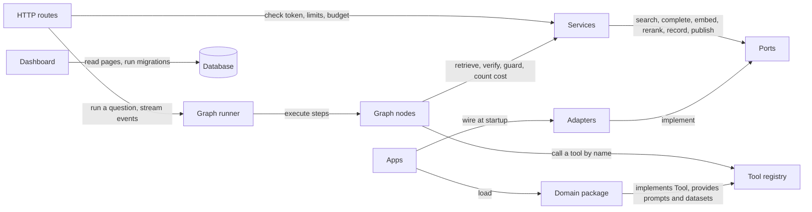
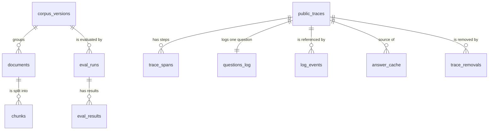
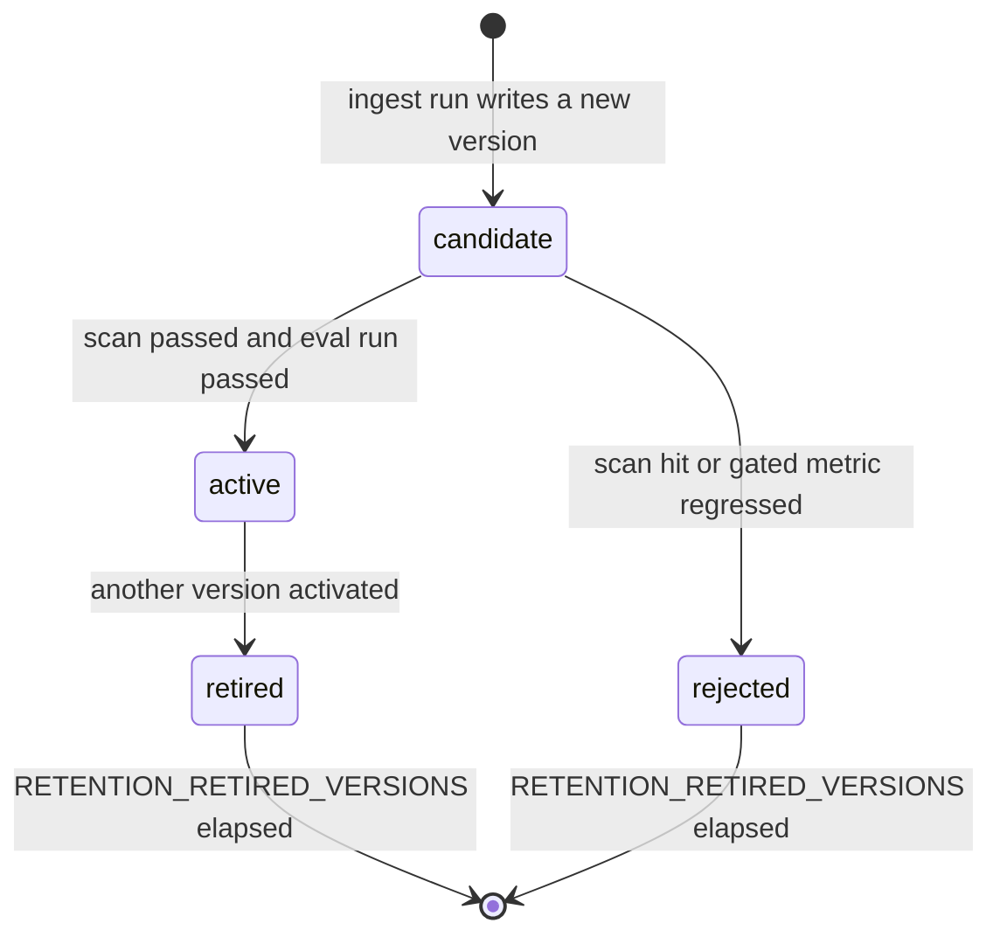
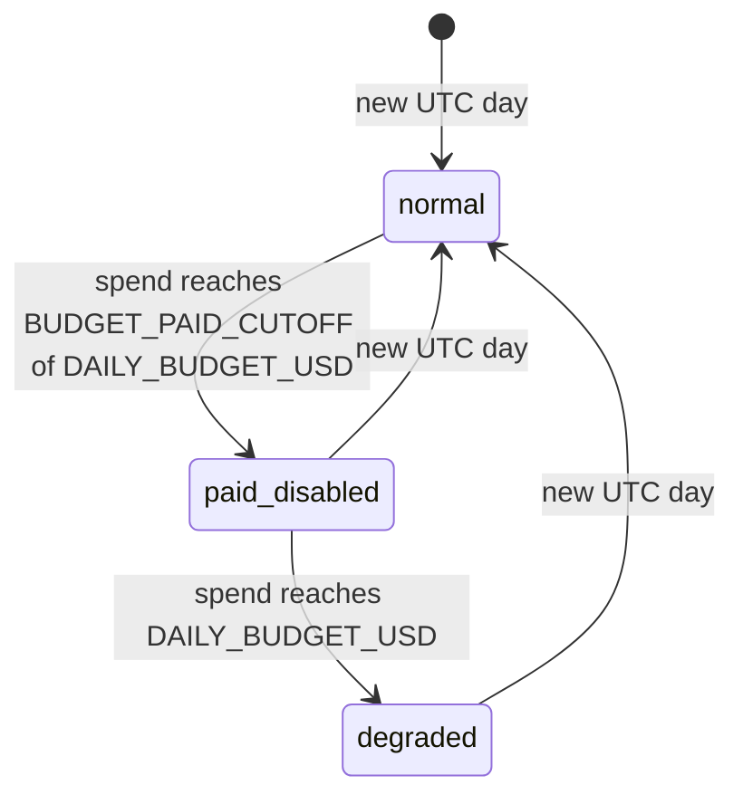

# LLD — zorzo.dev.br (zorzo-api)

2026-11-27 · André de Castro Zorzo · Status: draft · HLD: [hld.md](hld.md)

Scope: the `zorzo-api` repository. The front (`zorzo-site`) keeps its own LLD for rendering and the 3D brain;
section 8 here covers only how the front behaves against the API, plus the dashboard pages.

Status labels used below: **existing**, **planned**, **to detail** (named, behavior known, shape not designed yet).

**Where each fact lives**

| Fact | Owner |
| --- | --- |
| HTTP contract | OpenAPI generated by FastAPI, snapshot in `contracts/openapi.json` (planned) |
| Stream contract | `contracts/sse-v1.schema.json`, generated from `rag_core.events` |
| Database schema | Django migrations in `apps/dashboard/data/migrations/` |
| Environment variables (type, required, default) | Each app's settings class: `AppSettings` in core and its subclasses in the API and ingest; the dashboard's Django settings |
| Rule values | `config/limits.yaml`; values decided in section 9 of this document |
| Model and rerank chains | `config/models.yaml`, `config/models.local.yaml`; schema in section 3 "Configuration" |
| Commands and project practices | `README.md`, `AGENTS.md` |
| Where each piece of code lives, and why | `docs/code-map.md` (planned; also a corpus source) |
| Front rendering, the 3D brain and its data | `zorzo-site`'s `docs/lld.md` |
| Vocabulary | [GLOSSARY.md](../GLOSSARY.md) |
| Architecture and its reasons | [hld.md](hld.md) |
| Decisions with their reasons | `docs/adr/`, indexed in section 11 here and in the HLD |
| Scope and audience | [product-brief.md](product-brief.md) |

While an owner is planned, the shape of what it will hold stays in this document; when the owner exists,
the shape leaves and a pointer stays.

## 1. Code structure

A uv workspace: one shared `core` package and three apps with their own images (ADR 0012).

```
zorzo-api/
  packages/core/        generic core: retrieval, model gateway, agent graph, verification,
                        guard, telemetry, ingest pipeline, eval harness; ports and adapters   (existing: settings,
                        errors, health, events, retrieval, search-only answer, ingest
                        pipeline, model gateway, budget, alerts,
                        Postgres/Ollama/rerank/gitleaks/publisher/LiteLLM/Telegram
                        adapters)
  apps/api/             FastAPI: HTTP routes, SSE, gate; wires core + domain at startup      (existing: healthz, ask)
  apps/dashboard/       Django: public /dash pages, the `data` app (schema owner), commands    (existing: schema)
  apps/ingest/          one-shot job: runs the core ingest pipeline for a domain              (existing)
  domains/zorzo/        domain parts (ADR 0011), inside the `domain_zorzo` package: corpus/,
                        examples.yaml, prompts/, intents.yaml, tools/, evals/ (datasets),
                        loaders.yaml, public.yaml                                             (existing: domain.yaml,
                                                                                              corpus/, examples.yaml)
  config/               models.yaml, models.local.yaml, limits.yaml                           (existing)
  contracts/            sse-v1.schema.json, openapi.json snapshot                             (existing: sse-v1)
  infra/                terraform/, compose files, Caddyfiles, systemd units and timers       (existing: compose,
                        Dockerfile)
  tests/fakes/          fake OpenRouter server, fake tools                                    (existing: OpenRouter,
                                                                                              Turnstile, alerter)
  docs/                 HLD, LLD, ADRs, PRDs, specs, tasks, code map (planned)                 (existing)
```

`DOMAIN=<name>` chooses which `domains/<name>` folder the apps load. Adapting the system to another domain
means adding `domains/<other>/`, not changing `core`.

| Role | Choice | Why |
| --- | --- | --- |
| Runtime and packaging | Python 3.13, uv workspace | One lockfile; `core` shared by API, ingest and evals without copies (ADR 0012) |
| API | FastAPI | HLD constraint |
| SSE | sse-starlette | Heartbeat, client disconnect and SSE framing built in |
| Agent | LangGraph (pinned to an exact version, 1.2.21) + langchain-core, LangChain 1.0+ | HLD constraint; 1.0 is the LTS line; bounded graph (ADR 0006); services reach the nodes through LangGraph's `Runtime` context; only `rag_core.agent` imports `langgraph` |
| Model clients | LiteLLM SDK `Router`, one model group per chain entry (the paid one too), pinned to an exact version | A maintained library for the calls, timeouts and cooldowns; no proxy server (ADR 0016) |
| Conversation state | langgraph-checkpoint-postgres | State in Postgres, not process memory (ADR 0001) |
| Database access (API, ingest) | psycopg 3 + SQLAlchemy Core with schema reflection, no ORM | Django owns the schema; no second copy of the columns |
| Dashboard | Django 5.2 LTS | HLD constraint; LTS keeps security fixes to April 2028 with one jump to the next LTS. Move to 6.2 LTS (April 2027) for native CSP and template partials |
| Dashboard charts | TBD | Candidates: Chart.js, Apache ECharts, uPlot, Observable Plot, server-rendered SVG |
| Embeddings | langchain-ollama `OllamaEmbeddings`; pinned tag starts at `bge-m3:567m`, 1024 dimensions | ADR 0008; 1024 fits every candidate model (section 12), so changing model is a re-ingest, not a migration |
| Local rerank | fastembed (ONNX) with `cross-encoder/mmarco-mMiniLMv2-L12-H384-v1` registered as a custom model (`onnx/model_quint8_avx2.onnx`), baked into the API image and loaded offline; every model file is checked against a pinned SHA-256, so a changed model is refused | ADR 0009; small (130 MB) and multilingual on CPU; fastembed has no built-in copy of it |
| Validation and settings | Pydantic v2 + pydantic-settings | Tool arguments, answer contract, config files, fail-fast settings |
| Extraction and chunking | LangChain document loaders (Markdown in the MVP; PDF loaders pluggable per domain) + `MarkdownHeaderTextSplitter` / `RecursiveCharacterTextSplitter` | The loader interface makes the PDF library a configuration choice; Docling is too heavy for the VPS. The résumé enters as owner-reviewed Markdown converted once from the PDF |
| Tracing | langsmith SDK + a custom LangChain CallbackHandler | The handler feeds SSE events and the public trace from the same step events |
| Evals | DeepEval + plain Python metrics | Decisions log, 2026-11-18 |
| Logs | structlog | Events with fields, `bind(trace_id=…)`, JSON in production, readable locally |
| Secret scan | gitleaks + a PII pass: phones by `phonenumbers` (Google's libphonenumber, BR and US plans, pinned), emails by our own extraction, CPF and card numbers by check digits | Ingest gate (HLD flow 6.3); real numbering plans keep year ranges and ports from counting as phones |
| Tests | pytest + pytest-asyncio; fake OpenRouter server | Real model calls only in eval runs |
| Lint and types | ruff + mypy | mypy has the Django plugin |
| Scheduled jobs | systemd timers on the VPS, calling Django commands and containers | Nothing extra running; logs in journald |

## 2. Components and dependencies

Piece types:

| Piece | Where | Responsibility | Never |
| --- | --- | --- | --- |
| HTTP routes | `apps/api` | Parse the request, run the gate, open the SSE stream, call the graph runner | Touch the database or providers directly |
| Graph nodes | `core/agent` | One per step of the graph; call services and the tool registry | Import FastAPI |
| Services | `core` | Gate, guard, retrieval, verification, budget: the rules | Open network connections |
| Ports | `core` | Interfaces for what lives outside | Hold logic |
| Adapters | `core/adapters` | The only place with network clients and SDKs; each implements a port | Hold business rules |
| Domain package | `domains/<name>` | Prompts, intents, tools (core `Tool` protocol), datasets, loader choices | Import adapters |
| Apps | `apps/api`, `apps/ingest`, evals | Wire adapters and the domain into the core at startup | Hold business rules |
| Dashboard | `apps/dashboard` | Public pages, schema owner, snapshot commands | Import `core` (ADR 0015) |

**Allowed dependencies**



Boxes are piece types; an arrow is an allowed call; anything without an arrow is not allowed.

Rules: no cycles; `core` never imports `apps/` or `domains/`; the dashboard never imports `core` (ADR 0015); nothing outside `core/adapters` opens a network
connection; the domain is chosen by `DOMAIN` and loaded by the apps, never by `core`.

**Ports**

| Port | Operation | Receives | Returns | Guarantees |
| --- | --- | --- | --- | --- |
| VectorStore | `search` | Query vector, query text, k, filters, corpus version | Hits with ids and scores | Hybrid in one query (vector + full-text + RRF); reads only the given version; a vector hit counts only at `SEARCH_MIN_SIMILARITY` or above; full text matches any term of the question (OR), in English and Portuguese |
| VectorStore | `upsert` | Chunks, candidate version | Written count | Idempotent by content hash |
| VectorStore | `activate` | Version | — | Atomic; exactly one active version (section 6.1) |
| ModelGateway | `complete` / `stream` | Stage, messages, optional output schema, deadline, the request's spend | Result, usage, cost, provider | Walks the stage's chain entry by entry, skipping entries in cooldown (section 6.6): the free entries, then the paid one under the day's budget and `REQUEST_COST_CAP_USD` (section 6.2); respects the deadline; records cost; raises "unavailable" when the chain is exhausted; `stream` falls back only before the first token |
| ModelGateway | `rerank` | Query, documents, deadline | Scores per document | The `rerank` stage's chain under the same rules; raises "unavailable" so the Reranker falls to the local level |
| ModelGateway | `mode` | — | Normal, or the degraded reason | `budget_exhausted`; with every free `answer` entry in cooldown and the paid entry unable to run (past the cutoff, cooling down, or none), `quota_exhausted` when each was cooled by a 429, otherwise `models_unavailable`; the route checks it after the gate |
| ModelRouter | `complete` / `stream` / `rerank` / `strike` / `cooldowns` | One entry's id, its messages or rerank input, timeout | Result with usage and the provider-reported cost; active cooldowns (entry, status, start, length) | The LiteLLM adapter, one entry per call; counts each of the entry's failures toward its cooldown once (`strike` counts a cut the gateway made at the entry's own time limit); no network call at import; never chains LiteLLM's exception (its text can quote the request) |
| Embedder | `embed` | Texts | Vectors + model tag | Always the pinned tag |
| Reranker | `rerank` (async) | Query, candidates, k | Ordered candidates + level used | A level may raise; the retrieval service falls to the next level, then to the fused order (ADR 0009) |
| BotCheck | `verify` | Token | Pass or fail | Fails closed when the provider errors |
| TraceSink | `record` | Step event | — | Feeds the SSE stream, the public trace and LangSmith; LangSmith is asynchronous and never blocks |
| Alerter | `send` | Alert kind, message | — | Delivers one message; the alerts service decides when to send (section 6.10) |
| EventLog | `write` | Level, component, event, fields | — | One `log_events` row, written in the background; never blocks the caller |
| DataPublisher | `publish` | Brain and corpus data for a version | Manifest | S3 adapter writes `data/<hash>/` and invalidates only the manifest; local adapter writes a folder the local Caddy serves |

Core modules: Retrieval, Ingest pipeline and Model gateway **existing**; Gate, Guard, Agent graph, Verification,
Telemetry and Eval harness **planned**. Responsibilities: HLD section "Architecture" (core and domain). Tools are
domain pieces, not ports (section 6.5).

## 3. Cross-cutting implementation concepts

### Security

- **Origin secret:** Caddy compares the custom header CloudFront sets with `ORIGIN_SECRET` and answers 403 when
  it doesn't match. Nothing behind Caddy repeats the check. Caddy also refuses `/dash/admin` from that path.
- **Client IP:** read from `CloudFront-Viewer-Address` (`ip:port`), which CloudFront sets; the origin
  secret keeps anyone else from reaching the API with it. Without the header, the socket peer when
  `APP_ENV=local`; in production the request is refused with `503 unavailable` and an `error` log, since
  behind Caddy every visitor would share one bucket. An IPv6 address is reduced to its `/64` prefix (one
  subscriber usually holds a whole `/64`); an IPv4 address is kept whole. The result is turned into
  `HMAC-SHA256(daily_salt, ip)` as soon as it enters the app, where `daily_salt = HMAC-SHA256(SALT_SEED,
  utc_date)`. The raw IP is never stored, logged or sent to Turnstile, and uvicorn's access log is off (its
  line holds the socket address).
- **Bot check:** every question carries a fresh Turnstile token, verified server-side with `siteverify`
  before anything else (only the body's shape is checked first, to read the token). Only `success` is read.
  A provider error, an answer that isn't JSON or no answer within `TIMEOUT_TURNSTILE` refuses the request,
  with no retry.
- **Input:** NFKC; characters of Unicode categories `Cc` and `Cf` removed (`Cf` holds the zero-width and
  bidi controls that hide text from a reader but not from a model), with tab and line breaks turned into
  spaces first; whitespace runs collapsed; trimmed; length capped at `MAX_QUESTION_CHARS` code points; body capped at
  `MAX_BODY_BYTES` in Caddy and again in the API, which counts the bytes as they arrive (a chunked body too)
  and answers `422 invalid_input`.
- **CORS:** one origin; the allowlist holds `https://zorzo.dev.br`, plus localhost when `APP_ENV=local`.
- **Admin:** the Django admin listens on a local port, reachable only through an SSH tunnel; its views are
  read-only, except the "remove from public view" action on traces, which sets `removed_at` and writes a
  `trace_removals` row.
- **Secrets:** read once at startup from settings; never logged, never in a trace. The canary lives in the
  environment. With `APP_ENV=production` the API refuses to start on Turnstile's test secrets or on the
  published local `SALT_SEED` (`infra/.env.example`), with which anyone could reverse the hashed IPs.

### Concurrency and idempotency

- **Rate limit:** the buckets of a question are updated by one multi-row `INSERT … ON CONFLICT DO UPDATE`
  that takes a token only where one is left, so concurrent requests from the same key can't both pass
  (section 6.7).
- **Budget, reserve then settle:** before a paid call, one conditional
  `INSERT … ON CONFLICT DO UPDATE … WHERE cost_usd + estimate <= cap` reserves the estimate; after the call, the row is corrected by
  `actual − estimate`. Two concurrent requests can't both cross the cap. The estimate rule is in section 6.2.
- **Ingest:** a Postgres advisory lock (`pg_try_advisory_lock`) allows one run at a time, and a second run
  exits at once instead of waiting; chunks upsert by content hash with `ON CONFLICT DO NOTHING`.
- **Alerts:** one row per kind in `alert_states`; a conditional insert opens the incident once, so concurrent
  failures send one message (section 6.10).
- **Tools:** within a request, a call keyed by `hash(tool, normalized args)` returns the memoized result
  (section 6.3).

### Transactions

- **Corpus activation:** one transaction turns the candidate `active` and the previous active `retired`.
- **Budget reservation:** a single statement.
- **End of a request:** the public trace, its spans, the questions-log row and the final cost are written in
  one transaction after the stream ends, never during it.
- **Migrations:** Django runs each in a transaction (Postgres DDL is transactional). Migrations stay
  backward compatible with the previous image: add first, remove in a later deploy (HLD flow 6.4).

### Errors

- **Before the stream opens** the gate runs, and its failures are plain HTTP responses with one body:
  `{"error": {"code", "message", "trace_id"}}`.

  | Code | Status | When |
  | --- | --- | --- |
  | `invalid_input` | 422 | Missing fields, question over `MAX_QUESTION_CHARS` |
  | `bot_check_failed` | 403 | Turnstile token invalid, expired, or the provider errored |
  | `rate_limited` | 429 | A bucket is empty; `Retry-After` says when to try again |
  | `unavailable` | 503 | The backend can't serve (database down, corpus tag mismatch) |
  | `not_found` | 404 | No route at that path |
  | `method_not_allowed` | 405 | The route exists but not with that method |
  | `internal` | 500 | A bug before the stream opened |

- A client that leaves while still sending its body is answered `499` with no body (it never arrives; the
  status keeps disconnects apart from refused input in the logs).
- **After the stream opens** the response is never an HTTP error. Outcomes are events: `blocked`, `degraded`,
  abstention inside `done`, and `error {code, message}` for bugs only, followed by `done` (section 5).
- **Who translates:** graph nodes never raise to the HTTP layer; they return a status in the graph state.
  FastAPI exception handlers map the gate's exceptions to the table above. A model or tool failure is never a
  500: it degrades or abstains (section 6.3).

### Logs

- Structured JSON on stdout through structlog, collected by Docker and journald. Every line carries
  `trace_id`, level and an event name.
- Edge and infrastructure events from the closed catalog (fallback, cooldown start and end, rate limit,
  deploy, ingest, snapshot failure) also go to `log_events`: per-request ones through the TraceSink, the
  others (cooldowns) through the EventLog port.
- The `httpx` and `httpcore` loggers run at `warning`: at `info` they log every request URL, and Telegram's
  URL holds the bot token. LiteLLM's loggers run at `critical`: its error lines carry tracebacks that can
  quote the request or the provider's answer; the gateway logs each model failure by kind.
- Levels: `info` for one summary line per request; `warning` for fallback, cooldown started, retry; `error` for
  bugs (recursion limit, "context too long", parse failure after the retry).
- Never logged: secrets, raw IP, the question before scrubbing, Turnstile tokens, full prompts (those exist
  only in LangSmith, masked).

### Configuration

- Each app has a pydantic-settings class validated at startup; a missing required variable stops the app
  before it serves (fail fast).
- `config/limits.yaml`, `config/models*.yaml` and the domain files are loaded into Pydantic models at
  startup; an invalid file stops the app.
- `model_config_version` is the SHA-256 of the canonical JSON of the loaded models config, limits and
  prompts, recorded with every answer; formatting and comments don't change it, so they don't invalidate the
  answer cache. The models file is `MODELS_FILE`, by default `config/models.yaml`, or `config/models.local.yaml`
  with `APP_ENV=local`.
- **Models config:** `providers` (each with `base_url`, where `${VAR}` is read from the environment at load, so
  the local profile's Ollama is `${OLLAMA_URL}/v1`; optional `key_env` and `kind`: `openrouter`, whose
  reported cost is read, or `openai` for any other OpenAI-compatible endpoint) and `stages`, exactly `route`, `rerank`, `answer` and `judge`, each with
  `max_tokens` and an ordered `chain` of `{provider, model}` entries; a paid entry has `paid: true` and
  `price` (`input_per_mtok`, `output_per_mtok`, US$ per million tokens). Only `rerank` may have an empty
  chain. In production every provider a chain uses needs its key, or the app doesn't start. Other model
  calls of the graph map onto these stages (`assess` and `reformulate` to `route`, `repair` to `answer`).
  The `rerank` stage's entries are called as a Cohere-style `/rerank` on the provider's base URL.
- **Database bounds:** the short statements of the gateway (budget reserve and settle, alert state, event
  rows) run in a transaction that sets Postgres `statement_timeout` and `lock_timeout` to
  `SHORT_STATEMENT_TIMEOUT`; the server ends a stuck statement, so there is no client-side timeout to cancel
  half-way. TCP keepalives and `tcp_user_timeout` end a connection to a dead server in seconds, and a request
  waits at most `POOL_WAIT` for a pooled connection.
- **Shutdown:** the gateway drains its background work (reservation releases, alerts, event rows) within
  `SHUTDOWN_DRAIN`, then cancels what is left and logs it, so a stuck write never holds the process.

## 4. Data

Conventions:

- snake_case names, tables in the plural.
- Ids are `bigint` identity; ids that appear in public URLs (trace ids) are random UUIDs.
- Times are `timestamptz` in UTC.
- Deletion is physical, done by the retention job (section 6.11); no soft delete.
- Django models in the `data` app own the schema. The API and ingest reflect it at startup (SQLAlchemy Core)
  and write SQL against it.
- The LangGraph checkpointer owns its tables in the `langgraph` schema, outside Django.
- Vector and chunk tables are ours, in the Django migrations (ADR 0013).
- Defaults the API or ingest rely on are database defaults, and foreign-key delete rules (`CASCADE`, `SET NULL`)
  are set in Postgres by a hand-written migration: both apps write SQL directly, so Django's Python-side
  emulation of `on_delete` would not apply to them.

**Entities**



Entities and relations only; standalone tables (`rate_buckets`, `budget_daily`, `defense_events`,
`external_snapshots`, `alert_states`) are listed below.

Columns, types, constraints and indexes live in the migrations. What is still planned keeps its shape here:

| Table | Status | Notes |
| --- | --- | --- |
| `corpus_versions` | existing | Status per section 6.1; at most one `active` (unique partial index) |
| `documents` | existing | Metadata from the document front matter |
| `chunks` | existing | `tsv` is built by ingest with the document language's text search configuration over heading path and content |
| `answer_cache` | existing | Looked up by embedding similarity (ADR 0014) |
| `public_traces` | existing | outcome: `answered`, `abstained`, `declined`, `blocked`, `degraded`, `cached`; `public_ok` defaults to false |
| `trace_spans` | existing | One row per step; feeds the latency and fallback charts |
| `trace_removals` | existing | Private record of the owner's manual removals; never shown in public |
| `questions_log` | existing | For eval curation; outlives its trace (`trace_id` set null) |
| `defense_events` | existing | |
| `log_events` | existing | Closed event catalog |
| `rate_buckets` | existing | |
| `budget_daily` | existing | Day in UTC |
| `eval_runs` | existing | run_kind: `pre_release`, `nightly`; `corpus_version` without a foreign key, so history outlives retired versions |
| `eval_results` | existing | One row per question per run; feeds failures and flipped verdicts on `/dash/evals` |
| `external_snapshots` | existing | |
| `alert_states` | existing | No `site_down` row: UptimeRobot sends it by email (section 6.10) |
| `entities`, `facts` | to detail | Phase 2, career graph |

Data rules that the schema doesn't show live in section 6 (states, retention) and section 3 (concurrency).

## 5. Interfaces

Conventions:

- Prefix `/api/v1/…`, except `/api/healthz`. A breaking change means `/api/v2/` (HLD "API style").
- Anonymous: requests carry a Turnstile token and an anonymous session id (a UUID the front generates).
- JSON fields in snake_case; error body and catalog in section 3 "Errors".
- HTTP shapes live here while `contracts/openapi.json` is planned; stream event payloads live in
  `contracts/sse-v1.schema.json`.

### HTTP routes

| Method and path | Status | Input | Output | Behavior |
| --- | --- | --- | --- | --- |
| `POST /api/v1/ask` | existing (search-only until the agent graph) | `q` (1 to `MAX_QUESTION_CHARS` characters after trimming), `session` (UUID), `turnstile` (non-empty; verified by the gate) | `200 text/event-stream`; errors per section 3, with `503 unavailable` also when there is no active corpus version or its `embed_model_tag` differs from the API's embedder | The gate runs before the stream opens; after it passes, the events below |
| `GET /api/healthz` | existing | — | `200 {status: ok, mode: normal \| degraded, db: ok}`, with `degraded` when the gateway's mode is a degraded reason (section 2, ModelGateway `mode`); `503 {status: down, mode: unknown, db: down}` when the database can't be reached | Never cached (`Cache-Control: no-store`; CloudFront caches no error responses for `/api/*`), no gate. Used by the front, the deploy smoke test and UptimeRobot |

JSON read routes for traces, evals, defenses, status and sources are not part of the API: the dashboard
serves those pages from the database (section 8, ADR 0015).

### Stream events

Payloads: `contracts/sse-v1.schema.json`.

| Event | Front use |
| --- | --- |
| `stage` | Lights the step on the HUD |
| `guard` | Defense indicator |
| `retrieval` | Brain points light up; ids match the chunk ids in `corpus.json` of the same version |
| `tool` | Tool label |
| `model` | Model label |
| `token` | Draft answer text |
| `claim` | Verified sentences replace the draft; removed claims shown as removed; a claim with verdict `gap` and no sources is the sentence naming the part of the question the sources don't cover |
| `usage` | Cost and latency counter |
| `blocked` | Blocked state |
| `degraded` | Search-only banner |
| `error` | Bugs only |
| `done` | `outcome` names the result (`answered`, `abstained`, `declined`, `blocked`, `degraded`, `error`, the stored outcomes' names; `cached` is a separate flag); link to the public trace; on an abstention or decline, `suggestion` is the id of the closest example question (section 6.3) |
| `ping` | None: an SSE comment `: ping`, every `PING_INTERVAL` while nothing else is sent, keeps CloudFront's origin timeout from firing |
| `graph` | **To detail** (Phase 2) |

Ordering rules (each one a contract test):

- `done` is always the last event, sent exactly once, unless the connection drops.
- `blocked` and `error` are followed only by `done`; `degraded` is followed only by its `retrieval` hits,
  then `done`.
- Every `token` comes before the first `claim`; after the first `claim` there are no more tokens.
- A cached answer sends `stage`, the cached `claim` events, `usage` (cost 0) and `done {cached: true}`, with no
  `token`.

v1 freezes at launch. Until then, the task that first sends an event may narrow its payload (enums, new
optional fields), since no client depends on it yet; after launch a breaking change means `/api/v2/`.

### Published data

What the ingest job publishes on activation (DataPublisher), read by the front without a deploy (ADR 0010):

- `manifest.json`: `{corpus_version, embed_model_tag, path: "data/<hash>/", published_at}`; the only file
  rewritten in place.
- `data/<hash>/corpus.json`: `{corpus_version, chunks: [{id, doc_key, title, kind, lang, heading, text,
  source_url, p}]}`; `id` is the chunk id the stream's `retrieval` and `claim` events use; `p` is `[x, y, z]`
  from a 3D PCA of the chunk's embedding, scaled to [-1, 1]; how the front maps it into the brain is in
  `zorzo-site`'s LLD, section "Brain data".
- `data/<hash>/examples.json`: `[{id, lang, text}]`, the domain's example questions; `done.suggestion` uses
  the same ids.
- `<hash>` is the SHA-256 of both files, so a folder never changes and publishing again is a no-op.

## 6. States and rules

### 6.1 Corpus version

**Corpus version states**



States of a corpus version; arrows carry the event that causes the transition.

- Exactly one `active` version at any time; activation is one transaction (section 3 "Transactions").
- A candidate is activated only with a linked `eval_run` that has `passed = true`, except with
  `APP_ENV=local`, where it may be activated without one; production never does.
- A change of `model_config_version` and a change of the judge model never ship in the same version: a
  new judge is used only after its agreement with a sample labeled by the owner reaches
  `JUDGE_AGREEMENT_MIN`, so quality is never measured with a new ruler and a new model at once.
- Documents without `reviewed_by_owner: true`, with missing or invalid front matter, or with a scan hit
  (gitleaks or the PII pass: emails, phone numbers, CPF, card numbers; entries of the domain's
  `pii_allowlist` pass; a symlinked file is refused, since gitleaks doesn't follow links: an exact string, case-insensitively, or a phone written with its +country code,
  which covers its international and national renderings), fail the run. The PII pass fails closed: text shaped like an
  address or a phone counts unless it is exactly a retina asset name or a semantic version, and a false
  hit is fixed by rewording the line. It guards against personal data that slips into the owner's own
  documents by accident; deliberate hiding (zero-width characters, HTML tags or encoded line breaks inside a
  number, a label glued to the digits) is out of its scope and left to the owner's review, and so are a phone
  without a (DD) or +CC marker inside a row of more than 12 numbers and a phone split into more than 6 groups
  right after another number; the candidate becomes `rejected`. The whole source is checked before
  anything is embedded or written, and the report names the file and the rule, never the match.
- A run that stops for any other reason (a failed embedding, an interruption) also rejects its candidate, so
  a half-written version isn't activated; if that reject fails, the run logs the error and the
  candidate is checked by hand.
- The API refuses to serve a version whose `embed_model_tag` differs from the loaded embedding model: it
  starts as `unavailable` (503) instead of serving mismatched vectors.
- A chunk's hash covers its `doc_key`, heading path and content. Unchanged chunks are copied by hash into
  the new version, without being embedded again, only from a version with the same `embed_model_tag`.
- After activation the job publishes the data of section 5 "Published data"; a failed publish leaves the
  version active and the job fails, to be run again.
- Deleting a version deletes its documents and chunks.

### 6.2 Daily budget

**Daily budget states**



States of the day's budget row; the day is UTC, so every visitor sees the same "today".

- The paid entry runs last, only when the stage's free entries are exhausted. It is a Router entry (so it
  cools down like the others), but its budget is ours: the Router's own budget checks only spend already
  recorded, so concurrent calls could pass the cap together (ADR 0016).
- In `paid_disabled` the chain stops before its paid entries; free entries still run.
- In `degraded` every question is answered in search-only mode; the `degraded` event gives the reason.
- Reserve, then settle (section 3). The estimate is `prompt_tokens × input_price + max_tokens × output_price`,
  with `prompt_tokens` counted as `ceil(characters / 3)` (conservative for English and Portuguese, no
  tokenizer). If it doesn't fit in what is left, the call doesn't happen and the next chain entry, or
  search-only, takes over.
- **Settle:** a call the provider refused (a 3xx or 4xx other than 408, a 503, a 429, context too long)
  settles at 0. Any other failure (timeout, 500, 502, 504, a dropped connection, the request cancelled) keeps
  its estimate, because the provider may have billed it. A success settles at the cost the provider
  reported (OpenRouter's `usage.cost`), otherwise at its usage times the configured price; a success without
  usage counts keeps the estimate. A stream's counts are never billed from (without the provider's usage
  frame, LiteLLM fills them in from its own tokenizer): a paid stream settles at the reported cost or the
  estimate. A reported cost that isn't a finite, non-negative number, or counts that aren't plausible, are
  ignored; a settle above `MAX_COST_OVER_ESTIMATE` times the estimate is a provider's bug and settles at that
  multiple.
- The reservation is shielded from cancellation: a request that leaves while reserving still gets an answer
  from the database, and a reservation that landed after the caller left is released in the background.
- The state moves on settle: when the settled spend crosses the cutoff, `paid_disabled_at` is set; at the cap,
  `degraded_at`. A reservation needs `paid_disabled_at` empty. `requests` counts reservations.
- Per-request ceiling `REQUEST_COST_CAP_USD`: before each model call, if the estimate doesn't fit in what the
  request has left, the agent answers with what it has.
- Free calls cost 0 in this table; their limit is the provider's (section 6.8).

### 6.3 Agent run

- **Routing:** `route` classifies the intent (`career_fact`, `about_andre`, `about_system`, `projects_live`,
  `contact`, `off_topic`) with structured output and rewrites a follow-up into a standalone question. Its
  output is `intent`, `standalone_question`, `language` (ISO 639-1), `follow_up` (the question refers to
  earlier turns) and `public_ok`: `public_ok` is: whether the question may appear on public pages, judged by content
  category (offensive, harassment, sexual content, attacks on other people, personal data), not by
  sentiment. It adds no model call and never changes the answer, only what public pages show (section 8). In the
  MVP `career_fact` (salary, availability, visa, time zone) goes through RAG over the FAQ only (retrieval
  filtered to `kind = faq`; with no FAQ passage the run abstains without an answer call); `off_topic` →
  decline, with no answer call; `contact` → `contact_options`; the other intents go through RAG.
- **Edge questions:** a follow-up with no history is an abstention with a fixed message asking what the
  visitor means; a question in a language other than English or Portuguese is answered in English, with one
  line saying the site answers in both. The suggestion on an abstention or decline is the domain's example
  question closest to the question by local embedding similarity (no model call).
- **Length:** answers aim at `ANSWER_WORDS_DEFAULT` words, and up to `ANSWER_WORDS_MAX` when the visitor asks
  for more detail; beyond that the answer suggests opening the sources.
- **Limits per request:** the graph's fixed path bounds its model calls: `route`, `assess`, `reformulate`
  (at most `MAX_REFORMULATE`), `answer` (plus the gateway's one schema retry, section 6.4), the judge,
  `repair` (at most `MAX_REPAIR`) and a second judge. The tool step (section 6.5) has its own bounds:
  `MAX_LOOP_MODEL_CALLS` model calls and `MAX_TOOL_CALLS` tool calls. `REQUEST_DEADLINE` of wall clock, and
  `RECURSION_LIMIT` as the LangGraph backstop. Reaching the backstop is a bug: the run abstains and logs
  `recursion_limit` at `error`; there is no alert kind for it (section 6.10).
- **Deadlines propagate:** each call gets `min(own timeout, time left − reserve)` and runs under
  `asyncio.timeout`, so it is really cancelled. Before `answer`, the reserve is `ANSWER_RESERVE`; if less time
  is left, the run goes to search-only. After `answer`, the judge gets `min(TIMEOUT_JUDGE, time left)`; if
  verification can't finish, unverified claims are not published and the answer becomes an abstention with
  sources. Verification is never skipped (ADR 0006).
- **Failures by moment:** `route`, `assess` or `reformulate` failing on every entry, or `answer` failing
  before its first token, sends the run to search-only (`degraded {reason: models_unavailable}`), with the
  passages already found or a retrieval of the raw question; too little time before `answer` is
  `degraded {reason: deadline}`. `answer` failing after its first token, or the judge failing or running
  out of time, ends in an abstention after the draft: a draft is never published unverified.
- **Retries:** one retry with jitter, only on timeout, 5xx or 429, and only if the remaining time covers it.
  After that a tool result becomes `{"status": "unavailable"}` and the answer says which source was missing.
- **Repeats:** a tool call whose key was already seen returns the memoized result; a second repeat forces
  `answer` or `abstain`. A step that adds no new chunk ids ends the loop.
- **Evidence:** no passage at all → abstain without calling `assess`. Below `RELEVANCE_FLOOR` (best fused
  score) the run abstains without calling `assess`; above `ASSESS_SKIP_SCORE` it skips `assess`. Both are
  calibrated on the eval set at M3 and off until then (always `assess`). `assess` saying the evidence is
  insufficient leads to one `reformulate`, a new retrieve and rerank with its query, and `answer`, with no
  second `assess`; the answer may still abstain.
- **Advisor** (the cheap model consults a stronger one only at a decision it cannot settle: borderline
  evidence after `reformulate`, `verify` failing before `repair`, low `route` confidence): off in the MVP behind a flag; turned on only if the M3 comparison justifies it.
- **Context window:** each call is assembled from fixed slots sized for the smallest window in the chain
  (system prompt, question, chunks ≤ `CONTEXT_MAX_TOKENS`, history ≤ `HISTORY_MAX_TOKENS`); over budget, the
  oldest history goes first, then the lowest-ranked whole chunks. A provider "context too long" error is a
  bug alert, not a retry.
- **Process model:** the API runs as one process (`API_WORKERS`). The work is I/O-bound (seconds waiting on
  providers), so one async process handles the concurrency; extra workers would duplicate hundreds of MB of
  libraries and the ONNX model on an 8 GB machine shared with Postgres and Ollama, and would split in-memory
  state such as the Router's cooldowns. The one CPU-bound step, local rerank, runs in a thread (`anyio.to_thread`). Revisit
  if event-loop lag shows in p95, the API's CPU saturates, or traffic passes 20 concurrent sessions; the path
  is two workers with the Router's cooldown state shared through Redis, which LiteLLM supports.

### 6.4 Answer contract and verification

- **Contract:** the answer node returns JSON with `answer_lang`, `claims[]` (each with `text` and
  `sources[]`), `gap` (one sentence naming the part of the question the passages don't cover, or null) and
  `abstained`. `sources` are passage numbers (1 to the number of passages in the prompt), which the service
  maps to chunk ids. The answer streams as JSON: the draft (`token`) is only the new characters of the
  claims' text, read from the growing JSON (langchain-core `parse_partial_json`), never JSON or passage
  numbers. JSON mode and fenced JSON are read. A draft that doesn't validate is asked once more through
  the schema-bound call (the gateway gives a schema miss one more try on the same entry, then the next
  entry); no more tokens are sent.
- **Per claim:** a cited id outside this request's retrieval set removes the claim. The judge labels each
  claim `supported`, `partial` or `unsupported` against its cited chunks only (one batched call).
  `unsupported` is removed; `partial` stays, softened, only if the judge marks the supported part (its text
  replaces the claim's). If no claim is `supported` or `partial`: repair once (the answer stage again, with
  the passages and the verdicts), verify again, then abstain.
- **What is sent:** the published answer's claims, each with its verdict (`unsupported` ones too, shown as
  removed), then the `gap` sentence as a last `claim` with no sources and verdict `gap`. After a repair only
  the repaired answer's claims are sent.
- **Abstention:** "not in my sources", plus related sources and the contact link.
- **About a real person:** third person always (first-person sources are rewritten); no salary, personal
  life, inferred opinions or comparisons; superlatives only when quoted verbatim from an `authority: 3`
  source; negative statements about employers or clients are declined.
- **Canary:** the canary in the output blocks the response (L5).

### 6.5 Tools

All read-only; arguments validated by Pydantic, with enums where possible. Tool outputs are treated as
untrusted data, like retrieved chunks.

| Tool | Status | Behavior |
| --- | --- | --- |
| `search_corpus` | planned | Same pipeline as retrieval; optional `kind` filter. Questions about the code land here, answered from `docs/code-map.md` |
| `get_document` | planned | `doc_key` from an enum of indexed documents → metadata and summary |
| `list_projects` | planned | Public projects with links and status, from corpus metadata |
| `github_activity` | planned | `repo` from the allowlist → the last `GITHUB_COMMITS_MAX` commits (title and date), open issues count, last release, from the public REST API; never reads repository content; cached `GITHUB_CACHE_TTL`; cited as a source with `fetched_at`; when GitHub is unavailable the answer says so and falls back to the corpus |
| `contact_options` | planned | Returns links only, from the domain config, in this order: LinkedIn, GitHub, email (`mailto:`); never sends anything |
| `check_answerable`, `query_career_graph` | to detail | Phase 2 (career graph) |

A code-search tool over the site's own repository (`search_site_code`) is not built: a curated `docs/code-map.md` (one section per module: what it
does, where it lives, its decisions and ADRs) is a corpus source instead.

### 6.6 Circuit breaker

**Cooldown of a chain entry (per stage, provider and model)**

```mermaid
stateDiagram-v2
    [*] --> available: process starts
    available --> cooling: a 429, 401 or 404; or the third other failure of the entry within BREAKER_COOLDOWN
    cooling --> available: Retry-After elapsed, or BREAKER_COOLDOWN without one
```



Each chain entry is its own model group on the LiteLLM Router (ADR 0016), in the API process memory; the
gateway walks the chain.

- Entries are tried in chain order, skipping those in cooldown; there is no same-entry retry
  (`num_retries=0`) and no Router fallback: the next entry is the retry.
- A 429, a 401 or a 404 cools an entry at once. Any other failure of the entry (a timeout, a 5xx, a dropped
  connection, a 402, an error choice or unreadable answer in a 200) counts, and the
  `FAILS_BEFORE_COOLDOWN + 1`-th within `BREAKER_COOLDOWN` cools it. The cooldown lasts the provider's
  `Retry-After`, or `BREAKER_COOLDOWN` without one; there is no half-open trial call. LiteLLM leaves some of
  these out of its own count (a dropped connection, a 402, what the adapter finds wrong in a 200); the
  adapter adds exactly those, through LiteLLM's counting, so each failure counts once.
- **Never counted:** a failure the request caused (a 400, a 403, a 413, a prompt too long), so a visitor's
  question can't cool an entry; a cut at the request's deadline (the call's own timeout is set past it, so
  the deadline's guard cancels the call); in the `rerank` stage, a later entry cut by the stage's shared
  window (only the window's first call can time out on its own).
- **Model misses never cool an entry:** an empty answer, or output that fails the requested schema, gets one
  more try on the same entry, then the chain moves on. The provider works, the model missed.
- Each call gets `TIMEOUT_<STAGE>` when that ends before the deadline; the `rerank` stage shares one
  `TIMEOUT_RERANK`, from its first call.
- The gateway reads the active cooldowns after each call and in `mode()`: a new one writes `cooldown_started`
  to `log_events` (entry, status, length), one gone writes `cooldown_ended`; one renewed for another cause
  counts as both, one renewed for the same cause before it ended as the same cooldown. `/dash/` shows the
  latest state per provider.
- In-memory state is correct because the API runs as one process (section 6.3, "Process model").

### 6.7 Rate limit

- Token bucket per hashed IP: `RATE_IP_BURST` per `RATE_IP_WINDOW`, plus `RATE_IP_DAILY` per UTC day.
- The same limits per session: `RATE_SESSION_BURST`, `RATE_SESSION_DAILY`.
- Four buckets per question, keyed `ip:<hmac>:burst`, `ip:<hmac>:<utc date>`, `session:<uuid>:burst` and
  `session:<uuid>:<utc date>`. Burst buckets refill continuously (`BURST` tokens per `WINDOW`); day buckets
  carry the date in the key and don't refill.
- All or nothing: one transaction takes a token from each of the four buckets (section 3 "Concurrency and
  idempotency"); if any is empty, it rolls back, so a refused question takes no token. Rows are written in a
  fixed key order, so concurrent requests can't deadlock.
- Over the limit: 429 with `Retry-After` in whole seconds, the longest wait among the empty buckets (until one
  token refills, or until the next UTC midnight for a day bucket), before the stream opens and before any
  model call.
- A database that fails is `503 unavailable`. Postgres ends a take's statement that waits on a lock or runs
  past 2 s (`LOCK_TIMEOUT_S` in the rate-limit adapter), so a stuck row fails in seconds; the whole gate
  runs within `REQUEST_DEADLINE`, which bounds the rest. A question the gate passes keeps what is left of
  that deadline for the answer.
- A cache hit still counts against the limit.

### 6.8 Free quota

- Free limits are the providers': a provider past its limit answers 429, and the entry cools for its
  `Retry-After` (section 6.6). Nothing is counted or read ahead from headers; OpenRouter's key endpoint is not
  polled. The cost is one failed call per entry when a limit is reached.
- With every free `answer` entry cooled by a 429 and the paid entry unable to run, questions go search-only
  with reason `quota_exhausted`.

### 6.9 Answer cache

- **Lookup:** after `guard` and `route` (it uses the standalone question and its language), before `retrieve`.
- **Hit:** similarity ≥ `CACHE_SIMILARITY`, same language, same `corpus_version` and `model_config_version`,
  not expired.
- **Stored:** only answered and verified responses; never abstentions, declines, blocks or degraded answers.
- **Expiry:** `CACHE_TTL`; a new corpus or model version invalidates entries by not matching.
- **In degraded mode:** the first question of a conversation (no history) is looked up with the raw question
  and a local language detector, without `route`; follow-ups go straight to search-only. Serving a hit
  without the model-based guard is safe: the stored answer was verified and the question can't change it.

### 6.10 Alerts

**Alert states (per kind)**

```mermaid
stateDiagram-v2
    [*] --> closed: no incident
    closed --> open: condition detected, opening message sent
    open --> open: condition repeats; reminder only after ALERT_REPEAT_AFTER
    open --> closed: condition clears, resolved message sent
```



Kinds: `site_down`, `budget_exhausted`, `providers_down`, `backup_failed`, `restore_failed`, `eval_regression`.

- One message when an incident opens, one when it closes, and a reminder every `ALERT_REPEAT_AFTER` while it
  stays open.
- `site_down` is sent by UptimeRobot itself, by email (its free plan has no Telegram), never through the
  API, so it arrives when the VPS is down; it has no row in `alert_states`.
  `budget_exhausted` and `providers_down` are detected by the API during requests. The other three come from
  the background tasks (section 7).
- `budget_exhausted` opens when the gateway sees the day `paid_disabled` (owner's decision: the owner hears at
  the paid cutoff, while free entries still answer), escalates when the day reaches `degraded`, and closes on
  the first check of a new UTC day; `providers_down` opens when every free `answer` entry is in cooldown and
  closes when one is back.
- A condition is checked against `alert_states` at most once per `ALERT_CHECK_INTERVAL` per kind, so an
  escalation is sent within that interval. A restart forgets what was sent and may repeat one message.
- An alerts service in core owns these rules over `alert_states`; the Alerter only delivers (Telegram in
  production, a log line locally). Sending runs in the background with a short timeout and never fails a
  request; messages carry the kind and counts, never visitor data.

### 6.11 Retention

The nightly retention task deletes:

- `questions_log` after `RETENTION_QUESTIONS`;
- `public_traces` and their `trace_spans` after `RETENTION_PUBLIC_TRACES`;
- `log_events` after `RETENTION_LOGS`;
- `answer_cache` after `CACHE_TTL`;
- `rate_buckets` rows not refilled for more than a day (their day or salt has passed);
- `retired` and `rejected` versions, with their documents and chunks, after `RETENTION_RETIRED_VERSIONS`;
- LangGraph threads idle longer than `SESSION_TTL`.

Daily salts need no deletion: they are derived from the date (section 3 "Security").

## 7. Background processes

| Task | Trigger | What it does | On failure | Status |
| --- | --- | --- | --- | --- |
| Ingest | GitHub Action on a push that changes `domains/*/corpus/`, running the ingest container over SSH | HLD flow 6.3; idempotent by hash, one run at a time (advisory lock) | Candidate `rejected`; the Action fails (GitHub emails) | planned |
| Snapshot pull | systemd timer every `SNAPSHOT_INTERVAL` → Django command | LangSmith stats and experiments plus UptimeRobot uptime into `external_snapshots`; a repeat only adds a newer point | `log_event`; pages show the last snapshot with its time | planned |
| Retention | Nightly systemd timer → Django command | Section 6.11; deletes by date condition, so a repeat deletes nothing more | `log_event`; the next night catches up | planned |
| Backup | Nightly systemd timer | `pg_dump` without the `langgraph` schema to the backup bucket; one file per date; lifecycle expiry after `BACKUP_RETENTION` | `log_event` + alert `backup_failed` | planned |
| Restore test | Monthly systemd timer | Restores the latest dump into a temporary database, checks row counts and the active version, drops it | Alert `restore_failed` | planned |
| Nightly eval | Nightly systemd timer → eval container | Small subset on the real `:free` models, so it measures what visitors get, into `eval_runs` | `log_event` + alert `eval_regression` | planned |

## 8. Client

### Front against the API

Behavior only; rendering and the 3D brain are in `zorzo-site`'s LLD.

- **Health:** on load, `GET /api/healthz` sets the state: `online`; `degraded` (search-only banner); `offline`
  (query box disabled, with a notice). While offline it checks again every `HEALTH_POLL_INTERVAL` and when
  the tab regains focus, and returns to `online` by itself.
- **Session:** a UUID created on the first question and kept in `sessionStorage`, so it lasts while the tab is
  open and survives a reload. A "new conversation" button creates a new UUID; after `SESSION_TTL` idle, the
  next question creates a new UUID and shows a "new conversation" notice.
- **Free-tier notice:** the answers run mostly on the free tiers of the providers in `config/models.yaml`,
  whose terms may let them train on what they receive, with the capped paid entry when those run out. A line
  under the question box, shown before any question, says the questions may be used to train models and asks
  for no personal data; the footer names the providers and the paid fallback. A provider added to or removed
  from the models config changes the footer too.
- **Asking:** the invisible Turnstile widget produces a token for each question; after a token is used the
  widget is reset and the next one is fetched in the background, so a question rarely waits. The widget's
  script loads on the first interaction with the question box, not on page load. The front sends `POST /api/v1/ask` with `fetch`
  and reads the SSE stream from the body (`EventSource` can't send a POST). A new question cancels the current
  stream (`AbortController`).
- **Reactions:**

  | Case | Reaction |
  | --- | --- |
  | `422 invalid_input` | Inline message under the input |
  | `403 bot_check_failed` | Runs Turnstile again once, then a message |
  | `429 rate_limited` | Shows when to try again, from `Retry-After` |
  | No Turnstile token (script blocked, widget error or timeout) | The message of a second `403`; nothing is sent |
  | `502`, `503`, `504` or network failure | `offline` state (`503` comes from the API; `502` and `504` from CloudFront or Caddy when the API doesn't answer) |
  | Stream dropped before `done` | "Connection lost, ask again" (no resume) |
  | `blocked` | The defense layer and the reason in plain words, a link to `/dash/defenses`, and "this was a mistake?" linking to the contact options |
  | `token` | Draft text, marked "checking against sources" |
  | `claim` | The checked claim replaces the draft, with numbered citations that open the passage, its source's title and link; a claim with verdict `unsupported` is shown struck through as "removed: not supported by the sources"; a `gap` claim is a plain note |
  | `degraded` | Banner plus up to `DEGRADED_MAX_PASSAGES` passages, each with its source's title and link; with none, "no matching sources for this question", the example questions and the contact options |
  | `done {outcome: abstained}` | The draft is replaced by "not in my sources", with the passages found and the contact link |
  | `done {outcome: declined}` | The decline message |
  | `done` with `suggestion` | The suggested example question and the contact options |
  | `error` | Generic message with the trace link |

- **Interface language:** `navigator.language` starting with `pt` → Portuguese, anything else → English; a
  toggle saves the choice in `localStorage`. The answer's language follows the question (HLD
  "Internationalization").

### Dashboard pages

| Route | Access | Reads | Shows | Status |
| --- | --- | --- | --- | --- |
| `/dash/` | Public | Traces, spans, budget, snapshots, log events | KPIs (questions and sessions, p50/p95, success and fallback rates, tokens in and out); stacked latency per step; intent distribution; questions per day; most cited documents; recent questions (only outcome `answered`, `abstained` or `cached`, with `public_ok` true and no `removed_at`), each linking to its trace; status (uptime, budget used today, active chain, cooldowns) | planned |
| `/dash/t/<id>` | Public (random UUID) | `public_traces`, `trace_spans` | Timeline of one answer: scrubbed question, retrieved chunks with scores, tools, models and fallbacks, claims with verdicts, cost and latency; with `public_ok` false the question shows as "[hidden: not shown in public]"; 410 "this trace was removed" when `removed_at` is set; 404 "this trace expired" after expiry | planned |
| `/dash/evals` | Public | `eval_runs`, `eval_results`, LangSmith snapshots | Latest run of the active version with date and pass or fail per target; each metric with one plain sentence, split by layer, PT and EN separately, `pre_release` and `nightly` separately; trend across versions with gate-blocked versions marked; failures of the latest run and verdicts flipped between the last two versions, without the answer when `career_fact` is true; links to the datasets; a stale notice when the latest `nightly` run is older than `EVAL_STALE_AFTER` | planned |
| `/dash/defenses` | Public | `defense_events`, eval runs | Blocks per layer and category (7 and 30 days) with one plain sentence per layer; examples only from the `adversarial` dataset, real attacks only as counts; false-block rate from the `benign_tricky` dataset | planned |
| `/dash/sources` | Public | `documents` of the active version | Each document with kind, date and link; the FAQ and career narrative readable in full on a page of their own | planned |
| `/dash/logs` | Public | — | Phase 2 | to detail |
| `/dash/admin` | Owner, SSH tunnel only | All tables | Read-only Django admin, except the "remove from public view" action on traces; the only place with a link to the full LangSmith trace | planned |

Pages are server-rendered and cached at the edge for `DASH_CACHE_TTL`, so a removal shows within that time;
no cache invalidation from the VPS for `/dash/*`.

## 9. Values and configuration

Rule values live in `config/limits.yaml` (a flat mapping of the names below in snake_case, each task adding
its own), versioned and validated at startup (configuration as code, HLD);
changing one is a reviewed PR recorded in `model_config_version`. Environment variables carry only secrets,
endpoints and per-environment switches.

**Rule values**

| Name | Value | Where it applies | Source |
| --- | --- | --- | --- |
| `MAX_QUESTION_CHARS` | 500 | Input normalization | `limits.yaml` |
| `MAX_BODY_BYTES` | 8 KB | Request body, in Caddy and in the API | Caddyfile, `limits.yaml` |
| `PING_INTERVAL` | 10 s | SSE heartbeat | `limits.yaml` |
| `REQUEST_DEADLINE` | 20 s | Whole request; the search-only path ends with `error` then `done` when it passes | `limits.yaml` |
| `ANSWER_RESERVE` | 12 s | Time kept for `answer` (section 6.3) | `limits.yaml` |
| `TIMEOUT_ROUTE` / `TIMEOUT_RERANK` / `TIMEOUT_ANSWER` / `TIMEOUT_JUDGE` | 3 s / 2.5 s / 12 s / 5 s | Model gateway per stage; the remote rerank of 20 candidates took 1.0 to 2.0 s when measured on 2026-11-25 | `limits.yaml` |
| `TIMEOUT_SEARCH_CORPUS` / `TIMEOUT_GITHUB_ACTIVITY` | 1.5 s / 2 s | Tools | `limits.yaml` |
| `TIMEOUT_TURNSTILE` | 3 s | Bot check (`siteverify`); Cloudflare sets no value | `limits.yaml` |
| `MAX_LOOP_MODEL_CALLS` | 2 | Tool step of the agent run (section 6.5) | `limits.yaml` |
| `MAX_TOOL_CALLS` | 3 | Agent run | `limits.yaml` |
| `MAX_REFORMULATE` / `MAX_REPAIR` | 1 / 1 | Agent run | `limits.yaml` |
| `RECURSION_LIMIT` | 12 | LangGraph backstop | `limits.yaml` |
| `RETRIEVAL_TOP_K` | 20 per search | Hybrid search | `limits.yaml` |
| `RRF_K` | 60 | Fusion | `limits.yaml` |
| `RERANK_TOP_N` | 6 | Rerank output | `limits.yaml` |
| `SEARCH_MIN_SIMILARITY` | 0.5 (cosine; calibrated at M3 with `RELEVANCE_FLOOR`) | Vector hits below it aren't matches, so a question with nothing similar gets no passages | `limits.yaml` |
| `CONTEXT_MAX_TOKENS` | 2,500 | Chunks in a prompt | `limits.yaml` |
| `CHUNK_TOKENS` / `CHUNK_OVERLAP` | ~400 / 15% | Chunking (an eval variable) | `limits.yaml` |
| `RELEVANCE_FLOOR` | Off until M3 (calibrated on the eval set) | Abstain threshold | `limits.yaml` (optional) |
| `ASSESS_SKIP_SCORE` | Off until M3 (calibrated on the eval set) | Skip `assess` | `limits.yaml` (optional) |
| `HISTORY_TURNS` / `HISTORY_SUMMARY_TOKENS` / `HISTORY_MAX_TOKENS` | 2 / 250 / 800 | Conversation state | `limits.yaml` |
| `SESSION_TTL` | 30 min | Checkpointer threads; front idle reset (section 8) | `limits.yaml`, front config |
| `RATE_IP_BURST` per `RATE_IP_WINDOW` | 10 per 10 min | Rate limit | `limits.yaml` |
| `RATE_IP_DAILY` | 40 | Rate limit | `limits.yaml` |
| `RATE_SESSION_BURST` / `RATE_SESSION_DAILY` | 10 per 10 min / 40 | Rate limit | `limits.yaml` |
| `DAILY_BUDGET_USD` | 0.10 | Paid spend per UTC day (from the one-time US$10 credit) | `limits.yaml` |
| `BUDGET_PAID_CUTOFF` | 80% | Paid entries disabled | `limits.yaml` |
| `REQUEST_COST_CAP_USD` | 0.01 | Per request | `limits.yaml` |
| `BREAKER_COOLDOWN` | 60 s | Cooldown of an entry when the provider sends no `Retry-After`; also the window of its failure count (section 6.6) | `limits.yaml` |
| `FAILS_BEFORE_COOLDOWN` | 2 | Failures of an entry before the next one cools it (section 6.6) | Code (`adapters/litellm_models.py`) |
| `MAX_COST_OVER_ESTIMATE` | 2× | Ceiling of a paid settle (section 6.2) | Code (`services/gateway.py`) |
| `DEADLINE_MARGIN` | 1 s | How far past the deadline a deadline-bound call's own timeout is set (section 6.6) | Code (`services/gateway.py`) |
| `CACHE_SIMILARITY` | 0.95 | Answer cache | `limits.yaml` |
| `CACHE_TTL` | 60 days | Answer cache | `limits.yaml` |
| `DEGRADED_MAX_PASSAGES` | 6 | Passages shown in search-only mode | `limits.yaml` |
| `ANSWER_WORDS_DEFAULT` / `ANSWER_WORDS_MAX` | 150 / 400 | Answer length (section 6.3) | `limits.yaml` |
| `RETENTION_QUESTIONS` | 90 days | Retention | `limits.yaml` |
| `RETENTION_PUBLIC_TRACES` | 30 days | Retention (spans included) | `limits.yaml` |
| `RETENTION_LOGS` | 14 days | Retention | `limits.yaml` |
| `RETENTION_RETIRED_VERSIONS` | 30 days | Retired and rejected versions | `limits.yaml` |
| `BACKUP_RETENTION` | 14 days | Backup bucket lifecycle | Terraform |
| `ALERT_REPEAT_AFTER` | 12 h | Alert reminders | `limits.yaml` |
| `ALERT_CHECK_INTERVAL` | 60 s | Per-kind alert check (section 6.10) | Code (`services/alerts.py`) |
| `SHORT_STATEMENT_TIMEOUT` / `POOL_WAIT` | 2 s / 5 s | Database bounds (section 3 "Configuration") | Code (`adapters/postgres.py`) |
| `SHUTDOWN_DRAIN` | 6 s | Gateway background work at shutdown | Code (`services/gateway.py`) |
| `SNAPSHOT_INTERVAL` | 15 min | Snapshot pull timer | systemd timer |
| `GITHUB_CACHE_TTL` | 10 min | `github_activity` | `limits.yaml` |
| `GITHUB_COMMITS_MAX` | 3 | `github_activity` | `limits.yaml` |
| `HEALTH_POLL_INTERVAL` | 30 s | Front, while offline | Front config |
| `DASH_CACHE_TTL` | 60 s | Edge cache of `/dash/*` | Terraform |
| `EVAL_STALE_AFTER` | 48 h | Stale notice on `/dash/evals` | `limits.yaml` |
| `JUDGE_AGREEMENT_MIN` | 90% | Judge change rule (section 6.1) | `limits.yaml` |
| `WAF_RATE_LIMIT` | 300 requests per 5 min per IP | WAF on `/api/*` | Terraform |
| `API_WORKERS` | 1 | uvicorn (section 6.3) | compose |

**Environment variables**

| Variable | Project | Meaning | Production source |
| --- | --- | --- | --- |
| `APP_ENV` | all | `local` or `production`; missing means `production` | env file |
| `HOST`, `PORT` | api | Bind address (default `127.0.0.1`) and port (default 8000) | env file |
| `LOG_LEVEL` | all | Log level | env file |
| `DOMAIN` | api, ingest, evals | Which `domains/<name>` to load | env file |
| `DATABASE_URL` | api, dashboard, ingest, evals | Postgres connection | secret |
| `POSTGRES_PASSWORD` | postgres (compose) | Database password; compose refuses to start without it, so no default reaches production | secret |
| `OLLAMA_URL`, `EMBED_MODEL_TAG` | api, ingest | Ollama endpoint (embeddings, and the local profile's chat models) and the pinned embedding tag | env file |
| `EMBEDDER`, `RERANKER` | api, ingest | `ollama` / `local`, or `fake` (deterministic, accepted only with `APP_ENV=local`) | env file |
| `LIMITS_FILE` | api, ingest | Path of `limits.yaml` | env file |
| `MODELS_FILE` | api | Path of the models config; default per `APP_ENV` (section 3 "Configuration") | env file |
| `RERANK_CACHE_DIR` | api | Where the rerank model is baked in the image | env file |
| `ORT_DISABLE_TELEMETRY` | api | `1`: onnxruntime sends no usage telemetry to Microsoft (also set in code) | image |
| `DATA_DIR` | ingest | Folder the local DataPublisher writes | env file |
| `OPENROUTER_API_KEY`, `GROQ_API_KEY`, `NVIDIA_API_KEY`, `GOOGLE_AI_API_KEY` | api, evals | Model providers | secret |
| `LANGSMITH_API_KEY`, `LANGSMITH_PROJECT`, `LANGSMITH_TRACING` | api, dashboard | Tracing and stats pull | secret / env file |
| `TURNSTILE_SECRET` | api | Bot check (the public site key is in the front) | secret |
| `ORIGIN_SECRET` | caddy | CloudFront origin header | secret |
| `CANARY`, `SALT_SEED` | api | Prompt-leak canary; seed of the daily IP salt | secret |
| `TELEGRAM_BOT_TOKEN`, `TELEGRAM_CHAT_ID` | api, dashboard, timers | Alerts; required by the API in production | secret |
| `UPTIMEROBOT_API_KEY` | dashboard | Uptime pull | secret |
| `AWS_DATA_WRITER_*`, `S3_BUCKET`, `CLOUDFRONT_DISTRIBUTION_ID` | ingest | Writes `data/` and invalidates the manifest | secret / env file |
| `AWS_BACKUP_WRITER_*`, `BACKUP_BUCKET` | backup timer | Writes dumps | secret / env file |
| `GITHUB_TOKEN` (optional, read-only) | api, ingest | `github_activity`, repo fetch | secret |
| `DJANGO_SECRET_KEY`, `DJANGO_ALLOWED_HOSTS` | dashboard | Django | secret / env file |
| `DEEPEVAL_TELEMETRY_OPT_OUT` | evals | `YES`: no telemetry | env file |
| `OLLAMA_KEEP_ALIVE` | ollama | `-1`: model stays loaded | env file |

Type, required flag and default belong to each app's settings class.

## 10. Development environment

What replaces each production service is in the HLD ("Deployment and environments"). What changes in code:

- **Profile:** `APP_ENV=local` selects `config/models.local.yaml`, where every chat stage points at Ollama with
  `qwen3:1.7b` (provisional until the quick eval) and the `rerank` chain is empty, so only the local
  cross-encoder runs; no key is needed.
- **Addresses:** services reach each other by compose name (`http://ollama:11434`, `postgres:5432`); tools run
  from the host use `localhost`. Both come from settings.
- **Edge pieces that don't exist locally:** a local Caddyfile without the origin-secret check; the client IP
  comes from the socket when the CloudFront header is absent; Turnstile uses Cloudflare's test keys (always
  pass, always fail), which the tests also use. The always-pass test secret accepts any token, not only the
  dummy one the test site keys produce.
- **DataPublisher:** the local adapter writes the brain data to a folder the local Caddy serves.
- **Alerter and tracing:** the alerter only logs; LangSmith is on only when a key is present.
- **Tests:** a separate test database per session, with the Django migrations applied by a fixture; the fake
  provider server (`tests/fakes/`, a small ASGI app on `127.0.0.1`, since LiteLLM builds its own HTTP
  clients) answers scripted responses, 429s, hangs, malformed
  JSON and canary leaks for the contract and fault tests. Real model calls only in eval runs.

## 11. Decisions

| ADR | Decision | Status |
| --- | --- | --- |
| [0012](adr/0012-uv-workspace-core-ports-domains.md) | uv workspace: a shared `core` with ports and adapters, plus `domains/<name>` | Accepted |
| [0013](adr/0013-own-chunk-tables-not-langchain-postgres.md) | Our own chunk tables in the Django migrations, not `langchain-postgres` | Accepted |
| [0014](adr/0014-semantic-answer-cache-in-postgres.md) | Semantic answer cache in Postgres (pgvector) | Accepted |
| [0015](adr/0015-dashboard-talks-to-api-through-database.md) | The dashboard talks to the API only through the database | Accepted |
| [0016](adr/0016-litellm-router-behind-the-model-gateway.md) | The LiteLLM Router runs the free chain behind the model gateway | Accepted |

Architecture decisions (0001–0011) are indexed in the HLD.

## 12. Open questions

- [ ] Embedding model among 1024-dimension multilingual models (`bge-m3`, `multilingual-e5-large`,
  `snowflake-arctic-embed2`, `qwen3-embedding:0.6b`), starting with `bge-m3`: decided by recall at M1.
- [ ] L2 guard classifier: a small local model or a cheap LLM classifier.
- [ ] Chat model of the local profile (Ollama): quick eval.
- [ ] Free models per stage (route, answer, judge): eval matrix at M3.
- [ ] `RELEVANCE_FLOOR` and `ASSESS_SKIP_SCORE`: calibrated at M3.
- [ ] Nemotron rerank (`nvidia/nemotron-3.5-rerank-8b:free`): limits and Portuguese quality (M5). The request
  shape (Cohere-style `query`, `documents`, `top_n` → `results[{index, relevance_score}]`) was confirmed live on
  2026-11-25; the response carries no rate-limit headers.
- [ ] Charts library for the dashboard.
- [ ] Eval harness: dataset format, metrics per layer, noise-band rule: to detail.
- [ ] A model that always answers empty or always misses the schema never cools its entry: revisit with the
  eval matrix at M3.
- [ ] A provider answering with `Retry-After: 0` makes LiteLLM skip the failure count, so such an entry never
  cools: rare, left untreated.
- [ ] Production restart policy: the API fails fast when Postgres is not ready at boot (Database), so the production compose needs `restart: unless-stopped` and a start order; to settle with the deploy feature.
